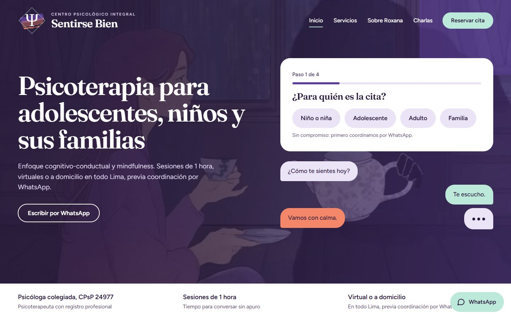
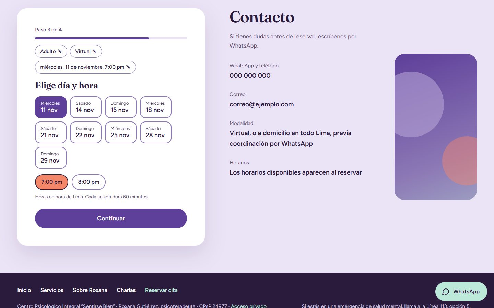
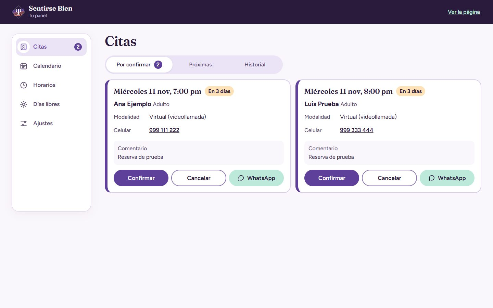
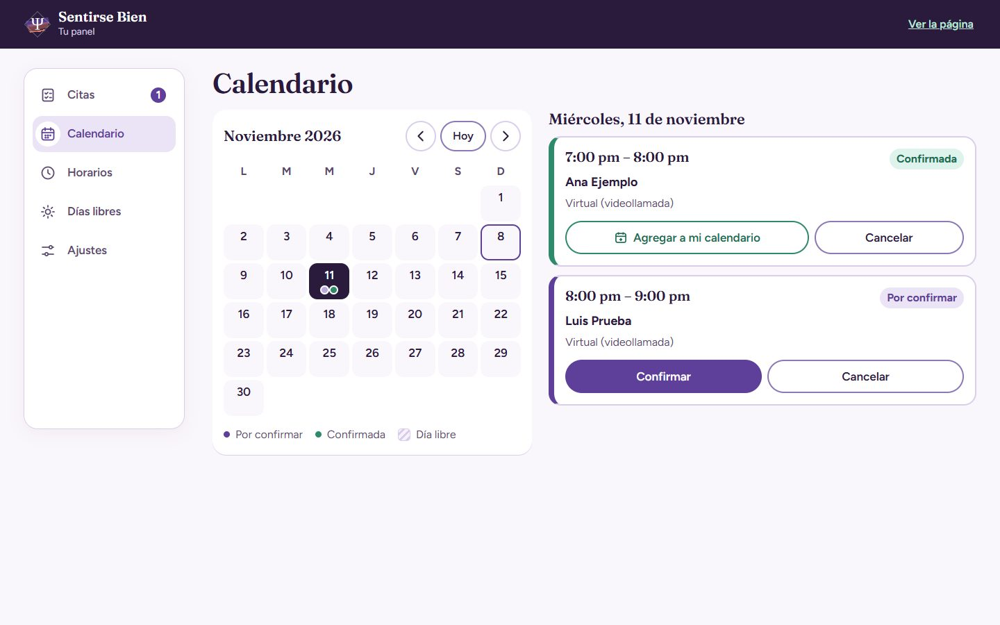
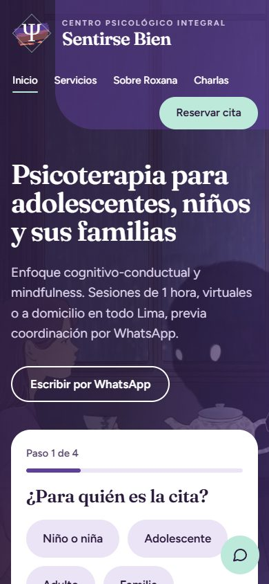
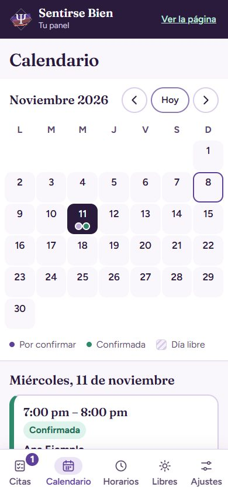

# Sentirse Bien

Landing y sistema de reservas para el **Centro Psicológico Integral «Sentirse Bien»** (Lima, Perú), un proyecto para una clienta real. Las personas eligen modalidad, día y hora, y solicitan su cita desde la web. La psicoterapeuta administra citas y horarios desde un panel privado pensado primero para celular, y confirma cada cita por WhatsApp.

**Demo:** https://sentirse-bien-demo.vercel.app

La demo funciona en modo demostración: no se conecta a ninguna base de datos y lo que hagas se guarda solo en tu navegador. Para ver el panel, entra a [`/admin/`](https://sentirse-bien-demo.vercel.app/admin/) con cualquier correo y contraseña.

## Capturas

| Inicio | Reserva |
|---|---|
|  |  |

| Panel: citas | Panel: calendario |
|---|---|
|  |  |

| Inicio en celular | Panel en celular |
|---|---|
|  |  |

Las capturas se tomaron en modo demo, con datos ficticios.

## Funcionalidades

**Sitio público**
- Cinco páginas: Inicio, Servicios, Sobre Roxana, Charlas y Reservar.
- Reserva en 4 pasos: para quién es la cita, modalidad (virtual o a domicilio), día y hora, y datos de contacto.
- Disponibilidad calculada según los horarios, los días libres y la anticipación mínima, siempre en hora de Lima.
- La cita queda pendiente hasta que se confirma por WhatsApp.
- Diseño responsive, navegación con teclado y respeto por `prefers-reduced-motion`.

**Panel de administración**
- Citas por confirmar, próximas e historial, con acciones para confirmar o cancelar.
- Calendario mensual con la agenda de cada día.
- Mensajes de WhatsApp ya redactados para avisar al paciente.
- «Agregar a mi calendario» con Google Calendar o archivo `.ics`.
- Configuración de horarios semanales, días libres y ajustes de reserva.
- Diseño responsive e instalable en el celular mediante un manifiesto web. No usa service worker, para no guardar datos de pacientes en el teléfono.

## Stack

| Área | Tecnología |
|---|---|
| Frontend | HTML, CSS y JavaScript con ES modules, sin frameworks ni build |
| Base de datos | Supabase: Postgres, funciones RPC y Row Level Security |
| Autenticación | Supabase Auth para la cuenta de administración |
| Modo demo | Backend alternativo en `localStorage` con la misma interfaz |
| Contacto | Enlaces de WhatsApp con el mensaje ya redactado |
| Despliegue | Vercel |

## Seguridad y privacidad

El sitio maneja datos de salud, así que el acceso se limita desde la base de datos:

- El público no lee ninguna tabla: solo llama a funciones RPC `security definer` que devuelven lo mínimo (`get_public_settings`, `get_available_slots`, `create_appointment`).
- Solo una cuenta registrada como administradora puede leer citas y editar horarios, mediante políticas RLS.
- Un índice único impide reservar dos veces la misma hora.
- Hay límites contra spam: 3 solicitudes pendientes por celular, y 5 solicitudes nuevas cada 10 minutos o 20 al día en total.
- Todo lo que escribe un paciente se escapa antes de mostrarse en el panel.
- No hay analítica ni scripts de seguimiento.

## Correrlo en local

No necesita instalar dependencias. Hace falta un servidor estático, porque los módulos de JavaScript no funcionan desde `file://`.

```bash
git clone https://github.com/rosalesdev928/sentirse-bien.git
cd sentirse-bien
cp js/config.example.js js/config.js
python -m http.server 5500
```

Abre http://localhost:5500 para el sitio y http://localhost:5500/admin/ para el panel. También sirve la extensión Live Server de VS Code.

Con `SUPABASE_URL` vacío, el sitio corre en **modo demo**: horarios y citas se guardan en `localStorage`, y el panel acepta cualquier correo y contraseña. El archivo `js/config.js` es obligatorio y no se versiona.

### Conectar Supabase (opcional)

1. Crea un proyecto en Supabase y ejecuta `supabase/schema.sql` en el SQL Editor. El script se puede volver a ejecutar.
2. Crea el usuario administrador en *Authentication → Users* y copia su UUID.
3. Regístralo como administrador:
   ```sql
   insert into public.admins (user_id) values ('UUID-DEL-USUARIO');
   ```
4. Desactiva el registro de nuevos usuarios en la configuración de *Authentication*.
5. Copia la URL del proyecto y la clave `anon` en `js/config.js`. La clave `service_role` nunca debe usarse en este proyecto.

## Estructura

```text
index.html, servicios.html, sobre-roxana.html, charlas.html, reservar.html
admin/                     Panel de administración
css/                       Estilos del sitio, el panel y el cursor
js/api.js                  Backends de Supabase y modo demo, con la misma interfaz
js/landing.js              Flujo de reserva
js/admin.js                Panel
js/config.example.js       Plantilla de configuración
partials/ y tools/sync.mjs Menú y pie compartidos entre páginas
supabase/schema.sql        Tablas, políticas RLS y funciones RPC
```

## Créditos

Desarrollado por [rosalesdev928](https://github.com/rosalesdev928). Las fotos, ilustraciones, textos y la marca pertenecen a la clienta y se muestran con su autorización.
